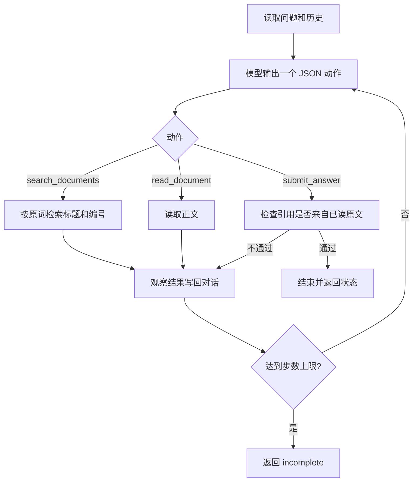

# 方案

循环在 `src/agent.py`。模型每步从 `search_documents`、`read_document`、`submit_answer` 里选一个，并写一句决策依据。运行时执行工具后把结果放回对话，下一步仍由模型选择。默认最多 8 步，输入里的 `max_steps` 可改成 1 到 12。

## 工具

| 工具 | 作用 |
|---|---|
| `search_documents` | 用问题里的连续词匹配标题和正文，只返回文档 ID、标题、版本日期。不返回正文，也不做同义词扩展 |
| `read_document` | 按文档 ID 返回全文 |

检索故意不扩展“带薪休假 → 年假”。原词没有命中时，要由模型决定是否换词再查。

## 提交检查

`submit_answer` 在写入最终结果前做三件事，不代替模型选择结论：

- 引用片段必须是已经读取的原文。
- 本次检索命中但还没读的文档，退回给模型继续读。
- 已读原文出现不同天数、又没有“优先适用”或“仅适用”时，拒绝 `completed`。模型可以改成 `needs_confirmation`，也可以继续查。

同一工具、相同参数连续失败两次后，观察结果里会提示提交 `tool_error`。最终状态仍来自模型提交的 `status`。

## 技术取舍

没有使用 Google ADK、LangGraph 或 AgentScope。题目要看的是模型能否根据工具结果改变下一步，标准库里的请求和循环足够表达这件事，评审也不需要安装框架。

真实模型走 OpenAI 兼容接口，默认对接环境变量里的 DeepSeek。`--provider scripted` 是离线策略，用来在没有密钥时跑通检索、空结果改写、冲突确认、工具失败和步数上限。它内部按固定规则选动作，只能证明流程，不能证明模型决策。

`examples/*.output.json` 来自 `--provider openai` 的一次真实调用。重新执行时温度设为 0，文字仍可能有小差异。
