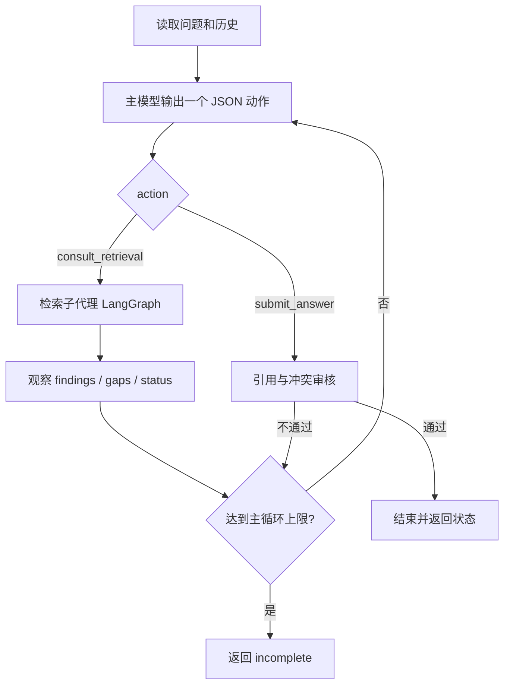
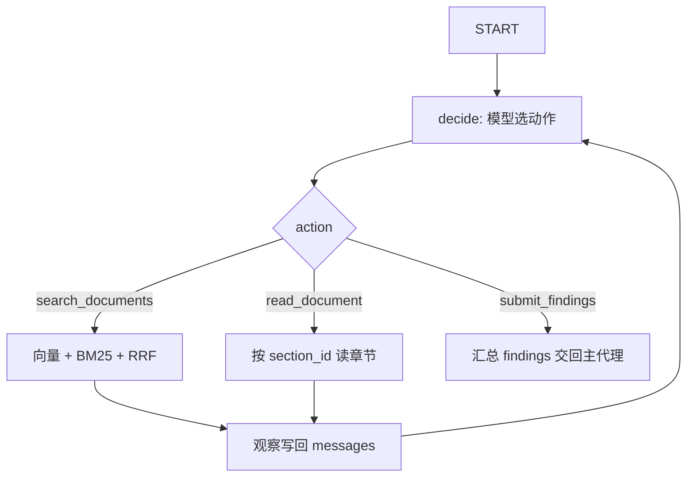

# 方案

## 调用流程

两层 ReAct：主代理负责判断问题与收口；检索子代理负责检索、阅读与改写。每步由模型输出一个 JSON 动作，运行时执行工具后把观察写回对话，下一步仍由模型选择。不是固定条件分支，也不是预设决策日志。



检索子代理内部：



主循环在 `src/harness/agent/loop.py`（入口 `src/agent.py` → `src/harness/runner.py`）。检索图在 `src/retrieval/graph.py`，由 `src/retrieval/agent.py` 调用。默认主循环最多 8 步，输入里的 `max_steps` 可改为 1–12；子代理内部 `decide` 也有上限，触顶后强制收口。

## 工具与职责

| 层级 | 工具 / 节点 | 作用 |
|---|---|---|
| 主代理 | `consult_retrieval` | 把制度问题交给检索子代理，自身不直接搜正文 |
| 主代理 | `submit_answer` | 提交最终状态与回答；经 `review_submission` 审核 |
| 子代理 | `search_documents` | 混合检索，只返回命中摘要（含 `section_id`），不返回可引用正文 |
| 子代理 | `read_document` | 按 `section_id` 读取章节原文 |
| 子代理 | `submit_findings` | 交回 `ready` / `needs_confirmation` / `insufficient_evidence` / `tool_error` 与 findings |

提示词约定（`src/llm.py`）：

- 第一次 `search_documents` 必须用用户原句，不做同义词预扩展。
- 仅当上一则检索没有命中时，才改写检索词（例如「PTO」→「年假」）。
- 同一事项的多版本文档都要读；冲突且无优先级时提交 `needs_confirmation`。
- 闲聊直接 `submit_answer`（`answer_kind=chat`），不调用检索。

## 检索链路

顺序：向量检索 → BM25 → RRF 融合 → 可选重排。中文分词用 jieba。配置了 `PGVECTOR_DATABASE_URL` 时向量走 Postgres `enterprise_qa.policy_chunks`；否则用 `data/kb/` 本地切片。构建与入库：

```sh
python3 -m src.retrieval.build
python3 -m src.retrieval.pgstore
```

## 提交检查

`submit_answer` 在写入最终结果前由 `src/harness/control/policy.py` 审核，不代替模型选择结论：

- `citations` 必须是对象数组 `{"doc_id","quote"}`，片段必须来自已读原文。
- 已读原文对年假天数或报销期限给出不同数字、且没有「优先适用 / 仅适用」时，拒绝 `completed`；模型应改为 `needs_confirmation` 并至少并列两段引用。
- `needs_confirmation` 必须写明要用户确认的问题。
- 主代理在检索返回 `tool_error` 时用相同 query 再试一次；第二次仍失败再提交 `tool_error`。

长期偏好（语言、详略、引用偏好）可选存于 Postgres `enterprise_qa` 记忆表，写入主代理系统提示；无库时跳过。

## 技术取舍

| 选择 | 原因 |
|---|---|
| 双层 ReAct，而非单环把搜读答绑死 | 主代理管「问够了没有 / 如何收口」，子代理管「怎么查、怎么读、怎么改写」；评审可单独看 `retrieval_trace` |
| LangGraph（`langgraph>=1.0.0`）只编排检索子环 | 用图表达 `decide → search \| read \| submit_findings`；边跟随模型刚选出的动作，不是写死的业务分支。主环仍用标准库循环，避免整栈绑死框架 |
| 第一次强制原句检索 | 让「空结果 → 改写」成为可观察的决策路径，而不是入口处同义词扩展掩盖问题 |
| 混合检索 + 读后引用 | 摘要不能当答案；引用必须来自 `read_document` 的连续原文 |
| 检查器只退回不合格提交 | 冲突停住必须发生在模型下一步；检查器不能替模型选定一边 |
| `--provider scripted` | 无密钥时跑通流程；`mode=scripted_mock`，不能证明真实模型决策 |
| 不用界面 / 部署 | 考核非必需；时间优先用于冲突、引用与 live 轨迹 |

真实模型走 OpenAI 兼容接口（默认 DeepSeek，`deepseek-v4-flash`）。`examples/*.output.json` 来自一次真实调用，`mode` 为 `live_model`。温度 0，再次执行措辞仍可能有小差异。

可选 LangSmith：`LANGSMITH_TRACING=true` 时上传主循环与检索 turn；密钥只放本机 `.env`。
